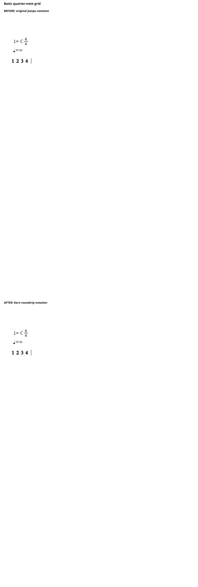
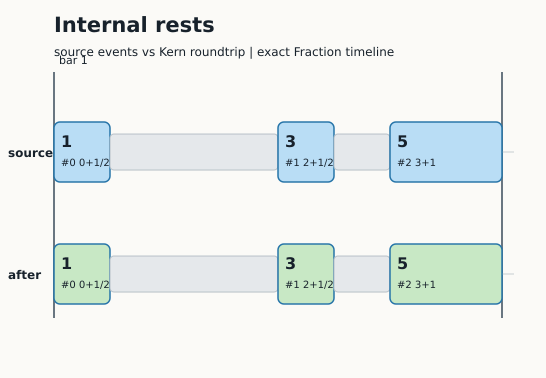
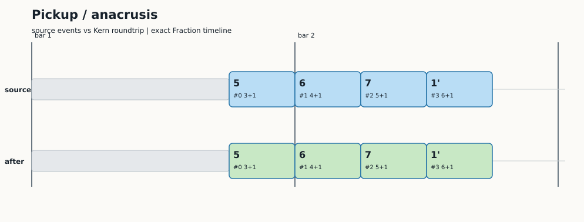
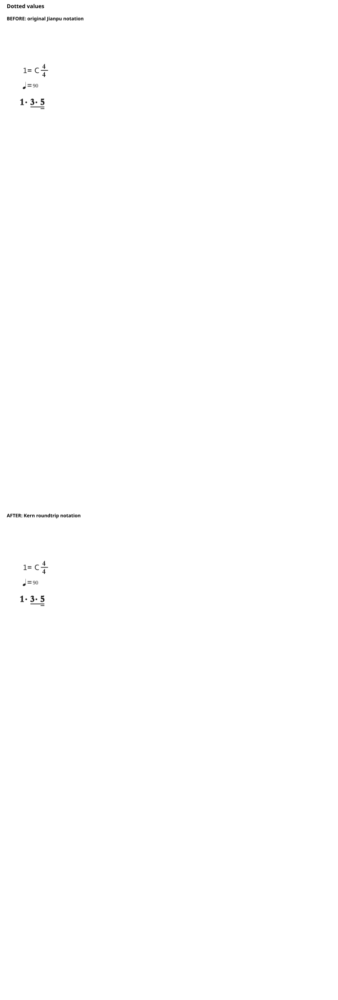
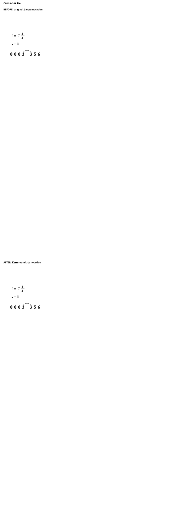
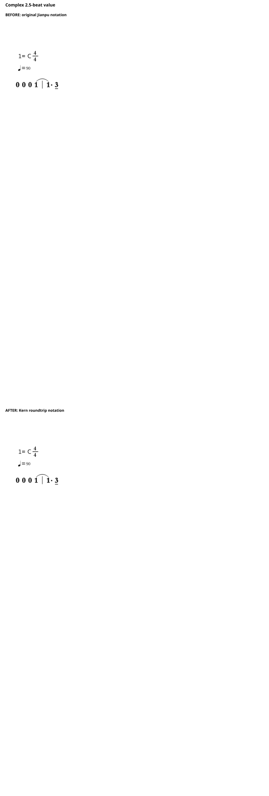
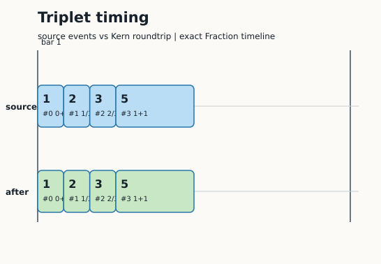
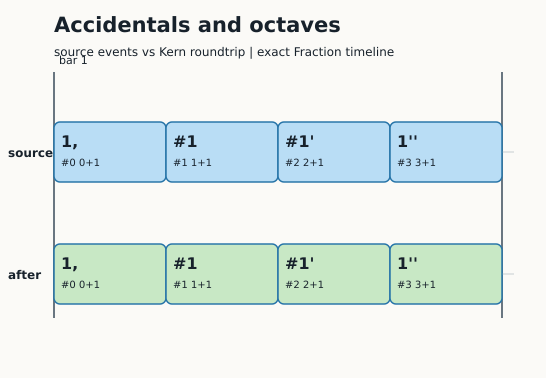
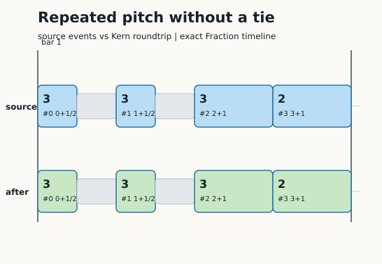
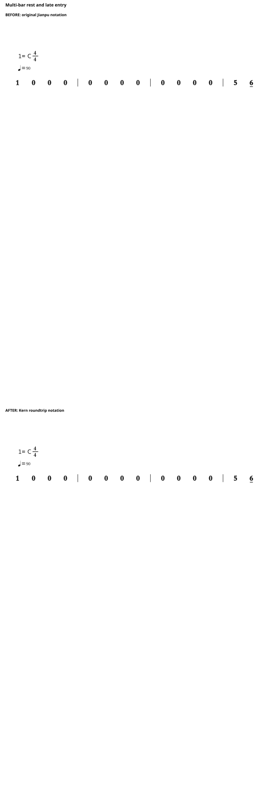

# Jianpu-Kern Converter

Event-level conversion between Jianpu-style beat timelines and Humdrum
`**kern` for 4/4 monophonic melodies.

This repository contains only the reusable conversion program, a small
dependency-free SVG renderer, and ten synthetic examples covering different
notation features. It does not contain the source corpus, training data,
audio, model weights, or third-party score-rendering assets.

## Result

The conversion target is the musical event tuple:

```text
(midi_pitch, absolute_onset_in_beats, duration_in_beats)
```

For the supported scope, the round trip is exact:

| Validation | Result |
|---|---:|
| 4/4 Jianpu-style events | 3,627 segments / 75,515 events |
| Synthetic edge-case examples | 10 / 10 exact |
| Real HookTheory `**kern` files | 100 files / 4,267 events |
| Pitch, onset, and duration mismatches | 0 |

The public examples are intentionally short and synthetic. Every example has
the source event JSON, generated Kern, source SVG, recovered SVG, and a
combined comparison SVG.

## Scope

Supported and tested:

- 4/4 single-spine monophonic melody
- MIDI pitch and exact Fraction beat positions
- explicit rests, including leading pickup rests
- notes crossing barlines
- Kern tie groups (`[` and `]`)
- dotted values and values that require exact splitting
- triplet values in the internal Fraction timeline
- conversion to the model-facing `[midi, bim, dur_q]` triples

Not silently claimed:

- original notation typography or glyph choices
- lyrics, chord symbols, ornaments, repeats, or multi-voice structure
- automatic recovery of pickup phase when an external Kern file omitted its
  leading rest
- lossless triplet timing in the integer `bim`/`dur_q` interface
- validation for 2/4, 3/4, 6/8, or arbitrary multi-spine scores

The exact event timeline is the lossless representation. The integer triple
interface uses a 0.25-beat grid for compatibility with the existing Jianpu
model data format; use `kern_to_jianpu()` when exact Fraction timing matters.

## Install

The library has no runtime dependencies beyond Python 3.10+:

```bash
python3 -m venv .venv
. .venv/bin/activate
python -m pip install -e .
```

## Quick Start

The input to `jianpu_to_kern()` can be either five-field rows from the
Jianpu-Melody data format:

```python
from jianpu_kern import jianpu_to_kern, kern_to_jianpu

melody = [
    [0.0, 1.0, 60, 0.0, 1.0],
    [1.0, 2.0, 62, 1.0, 1.0],
    [2.0, 3.0, 64, 2.0, 1.0],
]

kern = jianpu_to_kern(melody, meter_bpb=4)
print(kern)

events = kern_to_jianpu(kern, meter_bpb=4)["events"]
print(events)
```

Or use normalized `(onset, duration, midi)` rows:

```python
from fractions import Fraction
from jianpu_kern import jianpu_to_kern, kern_to_timeline

events = [
    (Fraction(3), Fraction(5, 2), 60),  # 2.5 beats: split and tied in Kern
    (Fraction(11, 2), Fraction(1, 2), 64),
]

kern = jianpu_to_kern(events, meter_bpb=4)
recovered = kern_to_timeline(kern)
assert recovered == events
```

The converter writes explicit rests before the first note and between notes,
splits notes at barlines, and uses Kern tie markers to preserve event identity.

## Rendering

`render_jianpu.py` creates a compact SVG from either event JSON or a single
spine Kern file. It uses only the Python standard library:

```bash
python3 render_jianpu.py \
  --events examples/06_complex_25.json \
  --out /tmp/source.svg

python3 render_jianpu.py \
  --kern examples/06_complex_25.krn \
  --out /tmp/recovered.svg
```

The repository's generated `*_comparison.svg` files show the source timeline
in blue and the Kern roundtrip timeline in green. This is a semantic event
rendering for conversion verification, not a replacement for a full
engraving engine.

## Ten Examples

Each row links to the source event data, generated Kern, and the combined
before/after rendering comparison.

| Feature | Source events | Kern | Rendering comparison |
|---|---|---|---|
| Basic quarter-note grid | [`JSON`](examples/01_basic_quarters.json) | [`KRn`](examples/01_basic_quarters.krn) | [`SVG`](examples/01_basic_quarters_comparison.svg) |
| Internal rests | [`JSON`](examples/02_internal_rests.json) | [`KRn`](examples/02_internal_rests.krn) | [`SVG`](examples/02_internal_rests_comparison.svg) |
| Pickup / anacrusis | [`JSON`](examples/03_pickup.json) | [`KRn`](examples/03_pickup.krn) | [`SVG`](examples/03_pickup_comparison.svg) |
| Dotted values | [`JSON`](examples/04_dotted_values.json) | [`KRn`](examples/04_dotted_values.krn) | [`SVG`](examples/04_dotted_values_comparison.svg) |
| Cross-bar tie | [`JSON`](examples/05_cross_bar_tie.json) | [`KRn`](examples/05_cross_bar_tie.krn) | [`SVG`](examples/05_cross_bar_tie_comparison.svg) |
| Complex 2.5-beat value | [`JSON`](examples/06_complex_25.json) | [`KRn`](examples/06_complex_25.krn) | [`SVG`](examples/06_complex_25_comparison.svg) |
| Triplet timing | [`JSON`](examples/07_triplets.json) | [`KRn`](examples/07_triplets.krn) | [`SVG`](examples/07_triplets_comparison.svg) |
| Accidentals and octaves | [`JSON`](examples/08_chromatic_octaves.json) | [`KRn`](examples/08_chromatic_octaves.krn) | [`SVG`](examples/08_chromatic_octaves_comparison.svg) |
| Repeated pitch, separate events | [`JSON`](examples/09_repeated_pitch.json) | [`KRn`](examples/09_repeated_pitch.krn) | [`SVG`](examples/09_repeated_pitch_comparison.svg) |
| Multi-bar rest and late entry | [`JSON`](examples/10_multi_bar_rest.json) | [`KRn`](examples/10_multi_bar_rest.krn) | [`SVG`](examples/10_multi_bar_rest_comparison.svg) |

The matching `*_before.svg` and `*_after.svg` files are also kept beside each
comparison so the two renderings can be inspected separately.

### Rendered Comparisons

Blue is the source event timeline; green is the timeline recovered after
`Jianpu -> Kern -> Jianpu`. The matching rows are exact in every case.

<details>
<summary>01 Basic quarter-note grid</summary>


</details>

<details>
<summary>02 Internal rests</summary>


</details>

<details>
<summary>03 Pickup / anacrusis</summary>


</details>

<details>
<summary>04 Dotted values</summary>


</details>

<details>
<summary>05 Cross-bar tie</summary>


</details>

<details>
<summary>06 Complex 2.5-beat value</summary>


</details>

<details>
<summary>07 Triplet timing</summary>


</details>

<details>
<summary>08 Accidentals and octaves</summary>


</details>

<details>
<summary>09 Repeated pitch, separate events</summary>


</details>

<details>
<summary>10 Multi-bar rest and late entry</summary>


</details>

## Reproduce the Examples

```bash
python3 tools/make_examples.py
```

The generator asserts exact equality between every source event list and its
Kern timeline after conversion.

## Files

```text
jianpu_kern/
  pitch.py          Kern pitch names <-> MIDI
  to_kern.py       Jianpu event timeline -> **kern
  from_kern.py     **kern -> exact timeline / triples / tokens
  kern_files.py    Parser for real multi-spine Kern files
render_jianpu.py   Dependency-free semantic SVG renderer
examples/          10 synthetic input/output/comparison examples
tools/              Reproducible example generator
```

## License

MIT. The examples and renderer in this repository are original small test
fixtures. No third-party score-rendering engine is bundled.
